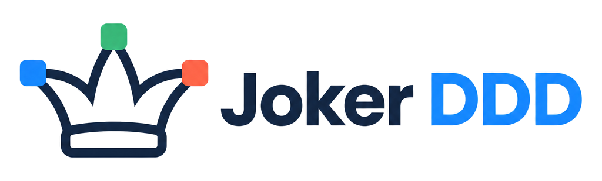

<p align="center">
  <picture>
    <source media="(prefers-color-scheme: dark)" srcset="docs/logo-dark.png">
    
  </picture>
</p>

<p align="center">
  Gerador de código que cria, em segundos, as classes e interfaces de Repository, Service e Application de um projeto C# em camadas DDD.
</p>

<p align="center">
  <a href="https://github.com/dotnet-estudos/GeradorArquivoDDD/actions/workflows/ci.yml"></a>
  
  
  
  <a href="LICENSE"></a>
</p>

---

## Por que existe

Em um projeto DDD, cada nova entidade exige o mesmo conjunto de arquivos repetitivos espalhados por várias camadas: interface e implementação do repositório, do serviço de domínio e do serviço de aplicação. Para uma entidade `Cliente`, são seis arquivos que só mudam o nome.

O Joker DDD nasceu em 2016 para eliminar esse trabalho manual: você informa as entidades, os diretórios e os namespaces do seu projeto, e ele escreve todos os arquivos de uma vez.

## O que ele gera

Para cada entidade, seis arquivos:

| Camada | Arquivo | Herda de |
|---|---|---|
| Domínio | `IClienteRepository.cs` | `IRepositoryBase<Cliente>` |
| Infraestrutura | `ClienteRepository.cs` | `RepositoryBase<Cliente>` |
| Domínio | `IClienteService.cs` | `IServiceBase<Cliente>` |
| Domínio | `ClienteService.cs` | `ServiceBase<Cliente>` |
| Aplicação | `IClienteAppService.cs` | `IAppServiceBase<Cliente>` |
| Aplicação | `ClienteAppService.cs` | `AppServiceBase<Cliente>` |

Os sufixos (`Repository`, `Service`, `AppService`, `Base`) são configuráveis, assim como o diretório e o namespace de cada camada.

Exemplo do `ClienteService.cs` gerado:

```csharp
using Loja.Domain.Entities;
using Loja.Domain.Interfaces.Repositories;
using Loja.Domain.Interfaces.Services;

namespace Loja.Domain.Services
{
    public class ClienteService : ServiceBase<Cliente>, IClienteService
    {
        private readonly IClienteRepository _clienteRepository;

        public ClienteService(IClienteRepository clienteRepository)
            : base(clienteRepository)
        {
            _clienteRepository = clienteRepository;
        }
    }
}
```

Os valores padrão da tela seguem a estrutura do [ProjetoModeloDDD](https://github.com/dotnet-estudos/ProjetoModeloDDD), o projeto de estudo em que o gerador foi usado.

## Como usar

1. Baixe o `JokerDDD-win.zip` da [página de releases](https://github.com/dotnet-estudos/GeradorArquivoDDD/releases) e extraia em qualquer pasta, ou compile a partir do código (veja abaixo).
2. Execute `WFGeradorArquivoDDD.exe`.
3. Preencha:
   - **Diretórios:** onde cada tipo de arquivo será gravado.
   - **Usings / namespaces:** o namespace de cada camada do seu projeto.
   - **Sufixos:** o padrão de nomes que seu projeto usa.
   - **Classes:** os nomes das entidades, separados por `;` (ex.: `Cliente;Produto;Pedido`).
4. Clique em **GERAR**.

Para não preencher tudo de novo a cada uso, salve a configuração em um arquivo XML e carregue-a depois pelos botões da tela.

Nomes de entidade inválidos (com espaço, hífen ou começando por número) são recusados antes de qualquer arquivo ser criado.

## Estrutura

```
GeradorDeArquivoDDD.sln
├── GeradorArquivoDDD.Dominio/   Motor de geração (GeradorClasses), configuração e serialização XML
├── WFGeradorArquivoDDD/         Interface Windows Forms
├── GeradorArquivoDDD.Tests/     Testes unitários (NUnit)
└── docs/                        Logo
```

A pasta `WFGeradorArquivoDDD/GeradorDeArquivoDDD/` guarda um protótipo inicial em WPF que não faz parte da solução.

## Compilar e testar

Com Visual Studio 2019 ou superior no Windows, abra `GeradorDeArquivoDDD.sln`, restaure os pacotes NuGet e compile. Os testes aparecem no Test Explorer.

Pela linha de comando:

```powershell
nuget restore GeradorDeArquivoDDD.sln
msbuild GeradorDeArquivoDDD.sln /p:Configuration=Release
packages\NUnit.ConsoleRunner.3.11.1\tools\nunit3-console.exe GeradorArquivoDDD.Tests\bin\Release\GeradorArquivoDDD.Tests.dll
```

Em macOS ou Linux, o build e os testes rodam com Mono via Docker (a interface gráfica não):

```bash
docker run --rm -v "$PWD":/src -w /src mono:6.12 bash -c '
  nuget restore GeradorDeArquivoDDD.sln &&
  msbuild GeradorDeArquivoDDD.sln /p:Configuration=Release /v:m &&
  mono packages/NUnit.ConsoleRunner.3.11.1/tools/nunit3-console.exe \
    GeradorArquivoDDD.Tests/bin/Release/GeradorArquivoDDD.Tests.dll'
```

## CI/CD

O workflow [`ci.yml`](.github/workflows/ci.yml) roda no GitHub Actions a cada push e pull request:

1. Restaura os pacotes e compila a solução em um runner Windows.
2. Executa os testes e guarda o resultado como artefato.
3. Empacota o executável em `JokerDDD-win.zip`.
4. Quando o push é de uma tag `v*` (ex.: `v1.1.0`), publica uma release no GitHub com o zip anexado.

Para lançar uma versão:

```bash
git tag v1.1.0
git push origin v1.1.0
```

## Histórico

| Período | Marco |
|---|---|
| set/2016 | Primeira versão: geração dos seis arquivos a partir da lista de entidades |
| out/2016 | Salvar e carregar a configuração em XML |
| 2026 | Motor de geração separado da interface, testes unitários, validação de nomes, caminhos com `Path.Combine`, código gerado sem espaços sobrando, .NET Framework 4.8 e CI/CD |

## Licença

Distribuído sob a [licença MIT](LICENSE).
